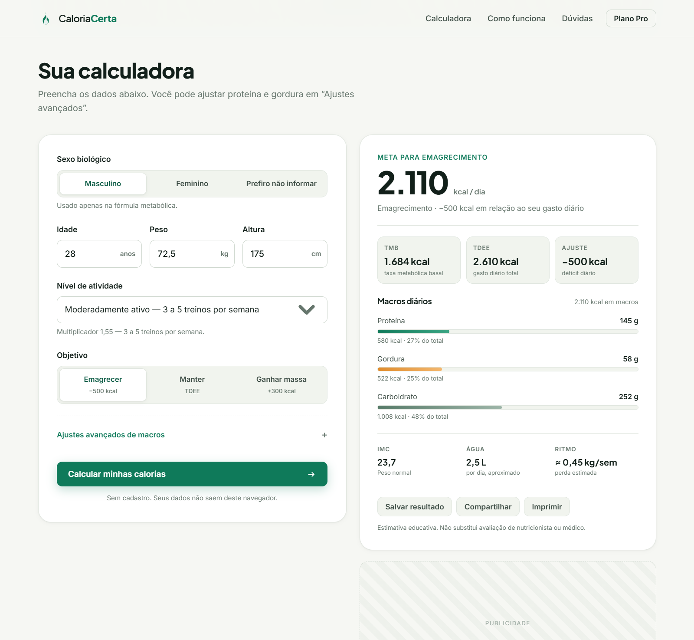

# Caloria Certa — Calculadora de TDEE e macros

Calculadora web gratuita que estima **gasto calórico diário (TDEE)**, **taxa metabólica basal (TMB)** e **macronutrientes** a partir de dados simples. Roda 100% no navegador, sem cadastro e sem enviar dados para servidores.

> Projeto de portfólio de **João Marcos Almeida** — versão web da calculadora TDEE originalmente desenvolvida em Java Swing.

---

## Demonstração

- **Site:** https://almeida-joaomarcos.github.io/tdee-web/
- **Versão desktop (Java Swing):** https://github.com/almeida-joaomarcos/calculadora-tdee



---

## Funcionalidades

- Cálculo de **TMB** pela equação de **Mifflin-St Jeor**
- **TDEE** com cinco níveis de atividade
- Meta calórica para **emagrecer (−500 kcal)**, **manter** ou **ganhar massa (+300 kcal)**
- Distribuição de **proteína, gordura e carboidrato** (g/kg configurável)
- **IMC** com classificação, estimativa de água diária e ritmo de ganho/perda
- Alertas de segurança (meta calórica mínima e macros incoerentes)
- **Histórico local** dos últimos cálculos (`localStorage`)
- Compartilhamento nativo (Web Share API) e impressão/PDF
- Layout responsivo, acessível e otimizado para SEO

## Stack

| Camada | Tecnologia |
| --- | --- |
| Interface | HTML5 + CSS3 (Grid/Flex, variáveis, `prefers-reduced-motion`) |
| Lógica | JavaScript puro (ES2020), sem dependências |
| Persistência | `localStorage` |
| Fontes | Google Fonts (Inter, Plus Jakarta Sans) |
| Deploy | GitHub Pages |

Sem build, sem `node_modules`: basta abrir o `index.html`.

## Como rodar localmente

```bash
git clone https://github.com/almeida-joaomarcos/tdee-web.git
cd tdee-web
```

Abra `index.html` no navegador ou suba um servidor estático:

```bash
# Python
python -m http.server 5500

# Node
npx serve .
```

## Fórmulas

**TMB — Mifflin-St Jeor**

```
Masculino:  (10 × peso) + (6,25 × altura) − (5 × idade) + 5
Feminino:   (10 × peso) + (6,25 × altura) − (5 × idade) − 161
Neutro:     (10 × peso) + (6,25 × altura) − (5 × idade) − 80
```

**TDEE**

```
TDEE = TMB × fator de atividade
```

| Nível | Fator |
| --- | --- |
| Sedentário | 1,2 |
| Levemente ativo | 1,375 |
| Moderadamente ativo | 1,55 |
| Muito ativo | 1,725 |
| Atleta | 1,9 |

**Macros**

```
Proteína (g) = peso × g/kg        → 4 kcal/g
Gordura  (g) = peso × g/kg        → 9 kcal/g
Carboidrato (g) = (meta − kcal de proteína e gordura) / 4
```

## Estrutura

```
tdee-web/
├── index.html      # marcação, conteúdo e SEO
├── styles.css      # design system e responsividade
├── app.js          # validação, cálculo, histórico e compartilhamento
├── favicon.svg
├── robots.txt
├── sitemap.xml
└── docs/
    └── preview.png
```

## Deploy no GitHub Pages

1. Crie o repositório `tdee-web` e envie os arquivos.
2. Em **Settings → Pages**, selecione **Deploy from a branch** → `main` → `/ (root)`.
3. O site fica em `https://<usuario>.github.io/tdee-web/`.
4. Para domínio próprio, adicione um arquivo `CNAME` com o domínio e configure o DNS.

## Monetização (roadmap)

O projeto foi desenhado para um modelo **freemium com anúncios**:

- [x] Calculadora gratuita e sem login
- [x] Espaços de anúncio preparados (basta inserir o bloco do AdSense)
- [x] Lista de espera para o Plano Pro
- [ ] Plano Pro: histórico ilimitado, plano alimentar por refeição, exportação em PDF e acompanhamento
- [ ] Integração com e-mail (Formspree/Buttondown) — hoje a lista é salva apenas no navegador
- [ ] Política de privacidade e termos de uso

## Aviso

Ferramenta **educativa**. Os resultados são estimativas e não substituem avaliação de nutricionista, médico ou educador físico.

## Licença

MIT — veja [LICENSE](LICENSE).
